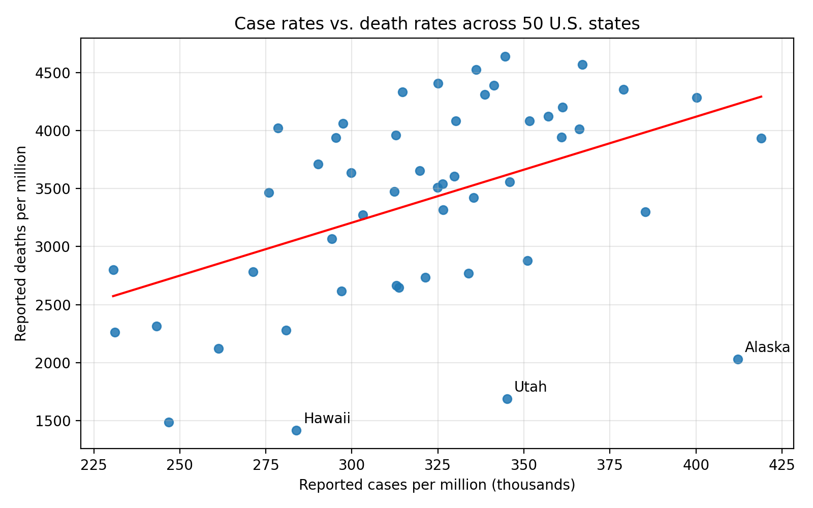

# COVID-19 Outcomes, Testing, and Vaccination: Exploratory Analysis

An exploratory statistical analysis of COVID-19 data for all 50 U.S. states and
vaccination coverage in 187 countries, done in Python.

*Full write-up:* [`report/COVID19_Analysis_Report.docx`](report/COVID19_Analysis_Report.docx)

# Research questions

1. Are reported COVID-19 case rates associated with death rates across U.S. states?
2. Are testing rates associated with case rates or death rates?
3. Which states are outliers, and do they change the conclusions?
4. How much does full vaccination coverage vary across countries, and how large is the gap between first-dose and full vaccination?

# Key findings

- *Case rates and death rates were moderately correlated across states* (r = 0.46, 95% CI 0.21 to 0.65, p < 0.001).
- *Regression:* each additional 10,000 reported cases per million was associated with about *91 additional deaths per million* (robust 95% CI 28 to 154). Case rate explained about 21% of the variation (R² = 0.21).
- *Outliers:* Alaska, Utah, and Hawaii had far fewer deaths than their case rates predicted (Alaska was the most influential, Cook's distance 0.57). Excluding them raised the slope to about 115 and R² to 0.40.
- *Testing rates* were not significantly correlated with case rates (r = 0.21, p = 0.15) or death rates (r = -0.18, p = 0.21) on their own.
- *Vaccination:* full coverage ranged from 0.2% to 99% across 187 countries (mean 55%, SD 25 points). The typical gap between first-dose and full coverage was about 5 percentage points, up to 26 in Venezuela.



# Methods

- Data-quality checks: duplicates, negative values, missing data, impossible values
- Descriptive statistics; Pearson correlation with Fisher-z confidence intervals; Spearman rank correlation as a check
- OLS regression, with heteroskedasticity-robust (HC3) standard errors
- Outlier and influence diagnostics: externally studentized residuals and Cook's distance
- Sensitivity analysis: refitting without flagged states

# Limitations

- Both files are *cross-sectional snapshots with no dates*, so trends over time cannot be analyzed. The original source and collection date were not recorded.
- Results show *association, not causation*.
- State/country-level data can't be applied to individuals (ecological fallacy).
- No age, healthcare capacity, density, or income variables; reporting practices vary by state and country.
- Small sample (n = 50); the testing-rate result was not pre-specified and is exploratory.
- Total Recovered and Active Cases were missing for five states (Indiana, New Hampshire, North Carolina, Pennsylvania, South Dakota) and were not analyzed.

# Run it yourself

```bash
pip install -r requirements.txt
python analysis.py
```

The script prints all results shown in the report and regenerates the figures in `figures/`.

# Project structure

```
data/      USA_Covid_Data.csv, Worldwide_Vaccine_Data.csv
figures/   scatterplots and histogram
report/    full written report (Word)
analysis.py
```

# Tools

Python, pandas, NumPy, SciPy, statsmodels, Matplotlib

# Author

Mariam Elbakri
